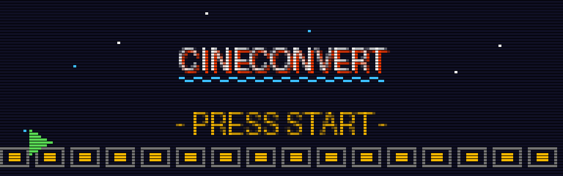
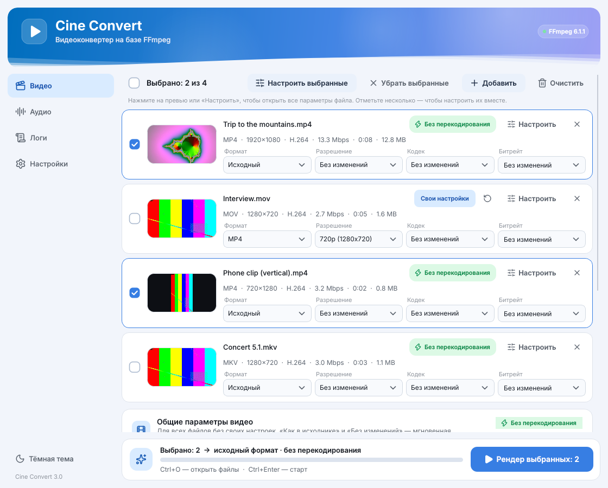
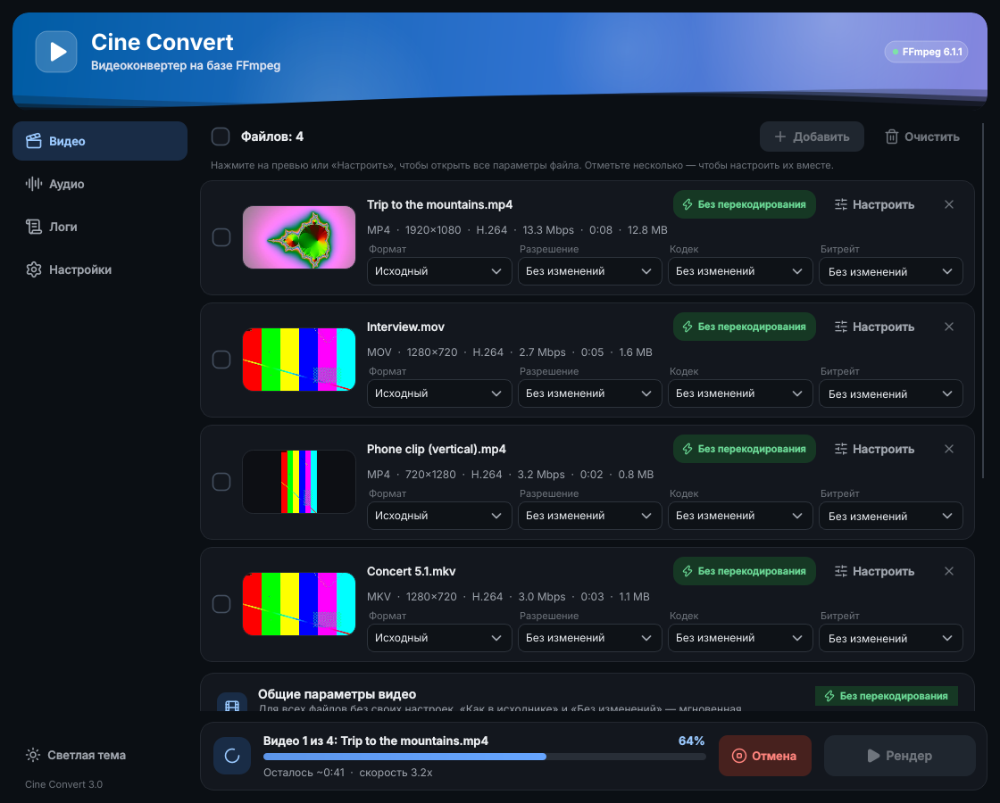
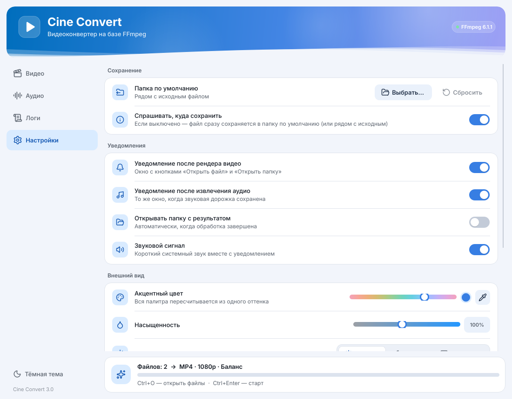
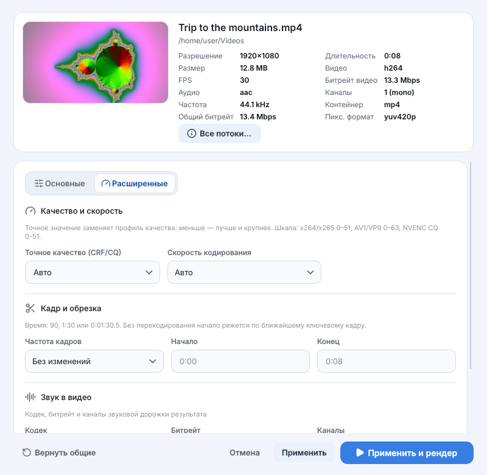
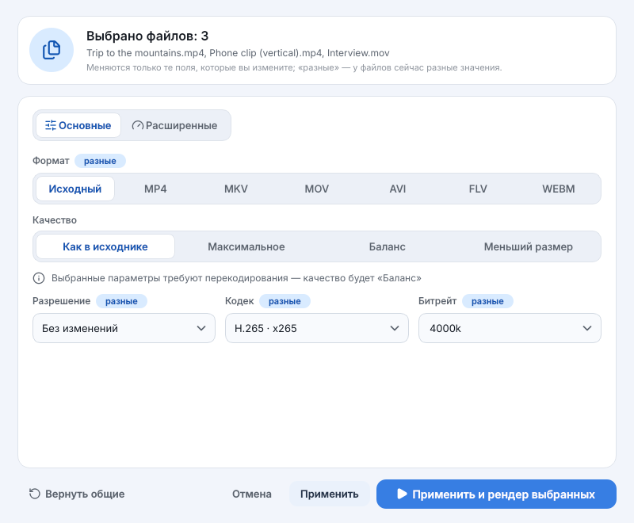
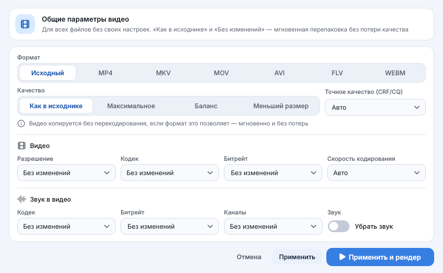
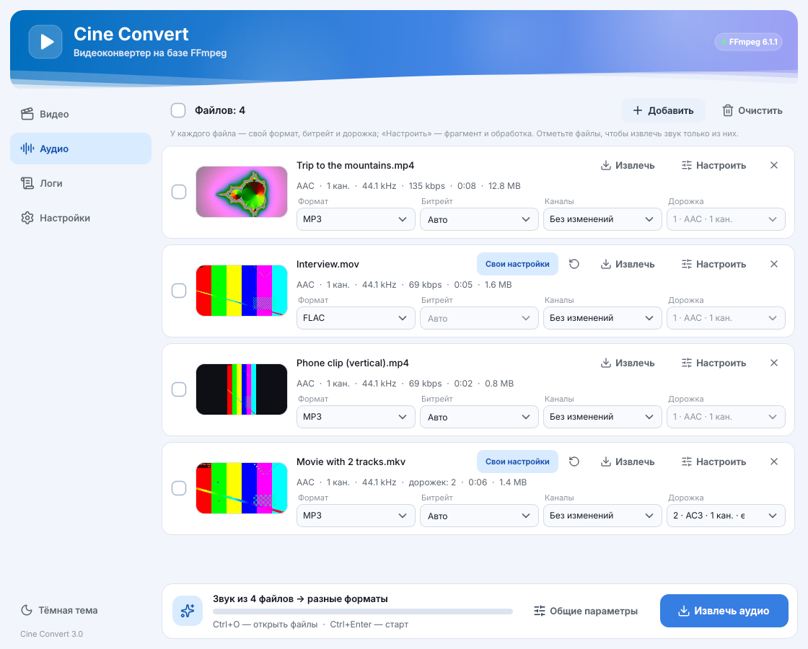
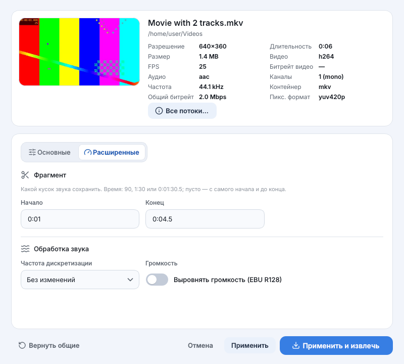

<div align="center">



# 🎮 CINECONVERT

**Portable FFmpeg-powered video converter for Windows, Linux and macOS**

*Insert cartridge • Press START • Convert*


</div>

---

```
════════════════════════════ STORY ════════════════════════════
```

**CineConvert** is a video converter that works **out of the box**: download it, run it, convert. No installer, no registry, no "please download this other thing first". All settings live in `config.json` right next to the program — carry it on a USB stick.

**FFmpeg** under the hood, a modern interface on top: sidebar navigation, a drag & drop zone, one action bar with progress, settings cards with toggles, the **Inter** font and **Lucide** icons. The live theme stays: pick any color with the rainbow slider and the whole app repaints instantly — light and dark modes included, and the animated waves still roll across the header.

<div align="center">



</div>

```
═══════════════════════════ POWER-UPS ═══════════════════════════
```

| | Feature | Description |
|---|---|---|
| 🗂 | **File list** | Every file gets a card: preview, format · resolution · codec · bitrate · duration · size, and quick combos to change format / resolution / codec / bitrate **for that file only** |
| 🔬 | **Per-file settings** | Click a preview or "Settings" to open a wide window for one video: preview, key characteristics and **every render setting on one page** — format, quality and exact CRF/CQ, resolution, codec, bitrate, speed, audio codec/bitrate/channels, mute |
| 🎛 | **Common settings** | The main page shows only the file list. "Common settings" in the bottom bar opens the same window for every file without its own settings. Changes show up on the cards at once, Cancel puts everything back |
| ☑ | **Selected files** | Tick files → "Set up selected" opens the window for all of them; only the fields you change are applied, "mixed" marks where files differ. Render / extract then works on the ticked files |
| 🧪 | **Advanced options** | Quality preset, exact CRF/CQ, encoding speed, audio codec/bitrate/channels, remove audio |
| 🔢 | **Bitrate presets** | Video bitrate from a list of 1000k…10000k in 1000k steps, or type your own (a bare number means kbit/s) |
| 🎬 | **Video conversion** | Resolution (4K→144p), codec (x264, x265, AV1, VP9, NVIDIA NVENC, Intel QSV, AMD AMF), bitrate, container (mp4, mkv, mov, avi, flv, webm) |
| 🎚 | **Quality presets** | *As source* / *Maximum* / *Balanced* / *Smaller file* — constant-quality encoding (CRF/CQ) with per-encoder values modelled on HandBrake's built-in presets. Smaller files with no visible loss instead of FFmpeg's bare defaults |
| ⚡ | **Smart lossless mode** | Streams are **copied 1:1** whenever the target container accepts the source codec: mp4→mkv *and* mkv→mp4 in a second with zero quality loss |
| 🧠 | **Safe defaults** | 4:2:0 pixel format for H.264 (plays everywhere), `hvc1` tag for HEVC in mp4/mov (Apple), `+faststart` for web playback, subtitles kept in MKV, audio auto-fixed for the container (Opus for WebM, MP3 for AVI) |
| 📐 | **Smart scaling** | Fits the frame into the chosen size: vertical videos stay vertical, no black bars, no upscaling, Lanczos scaler |
| 🖥 | **Hardware encoders** | NVENC / QSV / AMF are test-encoded before the run; if the GPU or driver can't do it, the software encoder takes over automatically |
| 🎧 | **Audio while converting** | Codec (aac, mp3, flac, opus, ac3), bitrate, channels (mono/stereo/5.1/7.1) or "copy as is" |
| 🎵 | **Audio extraction** | Rip audio to mp3, aac, flac, wav, ogg, opus, ac3 — copied without re-encoding when the track already is in that format |
| 🎧 | **Per-file extraction** | On the Audio page every card has its own format, bitrate, channels and **audio track** (language/commentary — real track names from the file) plus an "Extract" button for just that video. "Settings" adds a **fragment** (start/end), sample rate and **loudness normalization** (EBU R128). Tick several to set them up or extract them together |
| 📦 | **Batch processing** | Drop several files on the window or use "Add" — they convert one by one, each with its own or the common settings; audio extraction works in batches too |
| 🔍 | **Video info** | Preview frame + 12 key facts at a glance; a "Details" button opens the full breakdown of every stream; with multiple files, page through them with ‹ › |
| 🎨 | **Live theme** | Any color (OKLCH slider + color picker), saturation, light/dark/system, a one-click theme toggle in the sidebar, animated waves in the header |
| 🌐 | **7 languages** | en, ru, de, es, fr, zh, ar — every screen is translated; translations are plain JSON, easy to add your own |
| ⌨ | **Shortcuts** | `Ctrl+O` open files · `Ctrl+Enter` start · `Ctrl+1…4` switch sections |
| 🔄 | **1-click FFmpeg update** | Settings → FFmpeg: downloads a fresh build for your system (Windows — gyan.dev, Linux — BtbN, macOS — Martin Riedl's signed builds) and swaps it in atomically, rolling back on failure. The folder button shows where FFmpeg lives |
| 💾 | **Everything auto-saves** | There is no "Save" button — every setting applies and persists instantly, including window size |

```
═══════════════════════════ CONTROLS ═══════════════════════════
```

1. **📂 Pick videos** — drop files onto the window or click the drop zone (multiple files allowed); each one appears in the list with its own card
2. **⚙ Tune them** — "Common settings" in the bottom bar applies to every file; change format / resolution / codec / bitrate right on a file's card, or open its "Settings" for everything at once. Tick several files and press "Set up selected" to configure them together. Leave everything on "As source" / "No changes" for an instant lossless remux
3. **▶ Hit "Render"** in the action bar at the bottom (with files ticked it renders only those) — the app asks where to save (or saves straight to the default folder, if you turn the question off), then shows progress, speed and ETA
4. **🏁 Done** — a notification with sound, plus "Open file" / "Open folder" buttons

Audio ripping lives in the **"Audio"** section: pick a format → "Extract audio".

```
══════════════════════════ SELECT LEVEL ══════════════════════════
                     (which file to download)
```

Grab the build for your system from [**Releases**](https://github.com/bboyJohnn/CineConvert/releases/latest):

| System | File | How to run |
|---|---|---|
| 🪟 **Windows 10/11** | 🕹 **CineConvert-portable.zip** — recommended | Unzip → run `CineConvert.exe` → it just works, fully offline. FFmpeg is bundled |
| 🪟 Windows (light) | 🪶 CineConvert.exe | Downloads FFmpeg by itself on first launch (internet needed once) |
| 🐧 **Linux x86_64** | **CineConvert-linux-x86_64.tar.gz** | Extract → run `CineConvert/CineConvert`. FFmpeg and Qt libraries bundled |
| 🍎 **macOS Apple Silicon** | **CineConvert-macos-apple-silicon.dmg** | Open → drag *CineConvert* into *Applications*. FFmpeg bundled |
| 🍎 macOS Intel | CineConvert-macos-intel.dmg | Same as above |

> Nothing to install: no Python, no libraries, no separate FFmpeg.
> **Windows** SmartScreen may warn about an unknown publisher — click "More info" → "Run anyway".
> **macOS** blocks apps that are not notarized by Apple on first launch — System Settings → Privacy & Security → "Open Anyway" (or `xattr -dr com.apple.quarantine /Applications/CineConvert.app`).

```
═══════════════════════════ SCREENSHOTS ═══════════════════════════
```

<div align="center">

| Dark theme | Settings |
|---|---|
|  |  |

| File settings (all on one page) | Several files at once |
|---|---|
|  |  |

| Common settings | Audio extraction per file |
|---|---|
|  |  |

| Extraction settings: track, fragment, loudness |
|---|
|  |

</div>

```
═══════════════════ CARTRIDGE SPECS ═══════════════════
```

- **Single source file** — the whole UI and logic in `CineConvert.py` (PyQt5/PyQt6-compatible)
- **Theme engine** — colors are computed in OKLCH (like modern CSS) and compiled into one Qt stylesheet on the fly
- **Typography & icons** — [Inter](https://rsms.me/inter/) (`fonts/`, SIL OFL 1.1, hinted for crisp Windows rendering) and [Lucide](https://lucide.dev) icons (ISC) rendered from SVG in the theme color
- **Encoding engine** — quality profiles per encoder, codec↔container compatibility tables, stream-copy decisions based on `ffprobe`
- **Workers** — FFmpeg runs in background threads, the UI never freezes, conversion is cancellable
- **Reliable FFmpeg updates** — download via `.part` with integrity check, the new binary is test-run before an atomic folder swap with backup and rollback
- **Config** — `config.json` next to the program (portable); inside a macOS `.app` or a read-only folder it goes to the user folder (`~/Library/Application Support/CineConvert`, `~/.local/share/CineConvert`, `%APPDATA%\CineConvert`): theme, language, output folder, common render and extraction settings, window size
- **Locales** — `locales/*.json`: key = widget objectName or item text; any file with a `"name"` field shows up in the language list automatically

```
════════════════════════ BUILD FROM SOURCE ════════════════════════
                    ↑ ↑ ↓ ↓ ← → ← → B A START
```

```bash
# Player 1 has joined
git clone https://github.com/bboyJohnn/CineConvert.git
cd CineConvert
pip install PyQt6 pyinstaller pillow

# Run from source (FFmpeg auto-downloads on first launch)
python CineConvert.py

# Build for the current OS with FFmpeg inside (output goes to release/):
#   Windows → CineConvert.exe + CineConvert-portable.zip
#   Linux   → CineConvert-linux-x86_64.tar.gz
#   macOS   → CineConvert-macos-<arch>.dmg
python build_release.py --selftest
```

All four builds are made by GitHub Actions (`.github/workflows/release.yml`): every pull request is built and self-tested on Windows, Linux and macOS; *Actions → Build & Release → Run workflow* (or pushing a `v*` tag) publishes a release.

```
═══════════════════════════ CONTINUE? ═══════════════════════════
```

- 📁 **`old/`** — the previous version of the app (single screen, old design). Kept for history
- 🐛 **Found a bug?** — open an [Issue](https://github.com/bboyJohnn/CineConvert/issues) with the log from the "Logs" tab
- 🧡 Built on [FFmpeg](https://ffmpeg.org/) (builds by [gyan.dev](https://www.gyan.dev/ffmpeg/builds/), [BtbN](https://github.com/BtbN/FFmpeg-Builds) and [Martin Riedl](https://ffmpeg.martin-riedl.de/)) and [PyQt6](https://pypi.org/project/PyQt6/); font [Inter](https://github.com/rsms/inter) (OFL), icons [Lucide](https://lucide.dev) (ISC); quality presets inspired by [HandBrake](https://handbrake.fr/)

<div align="center">

```
  GAME OVER? NO — JUST PRESS "RENDER" AGAIN
  © bboyJohnn • CONTINUE ▶
```

</div>
